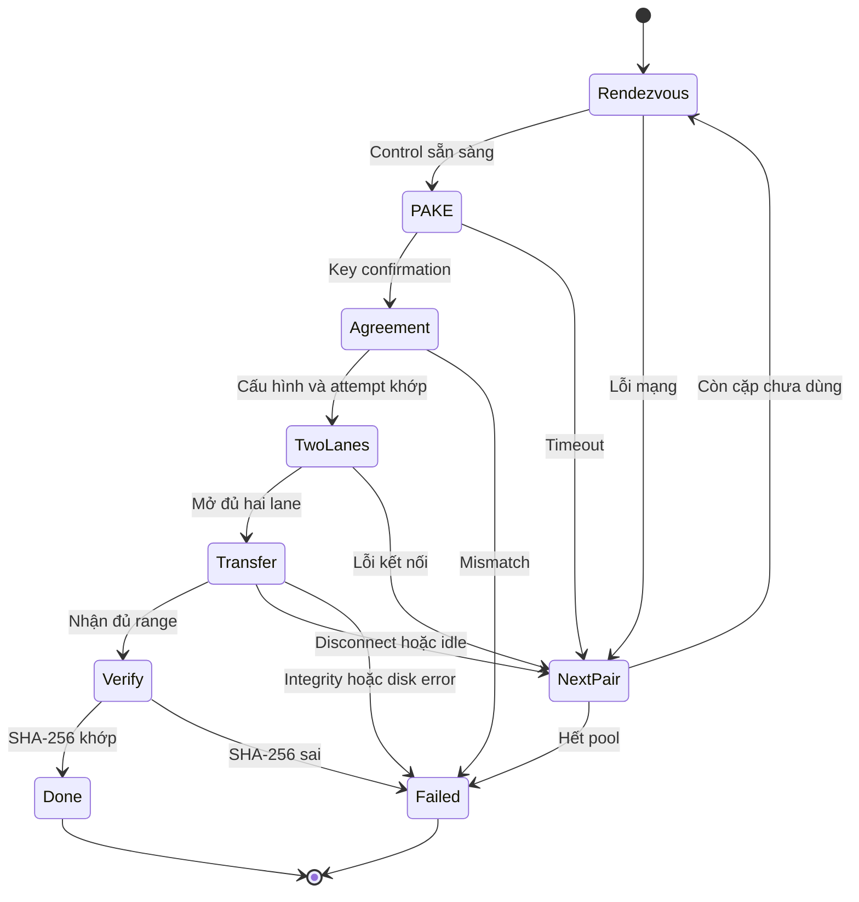

# Kiến trúc Multi-Relay

## Điểm tích hợp

`Client.Send`, `Client.Receive`, `sendData`, `receiveData` và hàng đợi chunk hiện có tiếp tục đảm nhiệm chuẩn bị file, I/O, compression, encryption và truyền dữ liệu. `multirelay.go` bổ sung vòng đời cặp relay và nhận diện tiến độ đã xác thực. Không tạo engine truyền file hoặc primitive mật mã mới. Relay server protocol không cần sửa. Mỗi relay được chạy với một control port và một data port trong môi trường minh họa.

Multi-Relay không quảng bá Tailcat, staged transport, progressive hash hoặc bundle transfer. Client ép đường truyền dùng đúng hai relay data connection. Cấu hình chọn relay ở CLI diễn ra trước public-relay discovery. Receiver vẫn giữ `TransportAuto` theo API hiện tại nhưng nhánh Multi-Relay không gọi transport auto-selection. Sender chọn relay. `--local`, `--ip`, `--no-multi`, QR và strict `derp` bị từ chối khi không tương thích.

## Phiên và đồng thuận

Control dùng relay đầu tiên của cặp đang xét. PAKE identity-bound v2 và key confirmation của Croc xác thực peer. Mỗi lần đổi cặp tạo PAKE session mới, salt mới và traffic key mới.

Sau PAKE, cả hai gửi `multirelay-agreement-v1` qua kênh đã mã hóa. Các trường gồm protocol version, fingerprint cấu hình có thứ tự, logical transfer ID, pair ID, attempt index và vai trò sender/receiver. So sánh khác biệt đã được xác thực thì dừng. Không rendezvous được chỉ báo lỗi kết nối hoặc hết pool, không tuyên bố đã xác minh config mismatch.

Control frame sau PAKE được bọc thêm bằng AES-GCM sẵn có của Croc. Plaintext của lớp bọc gồm `direction byte || uint64 sequence (big endian) || original encrypted control frame`. Counter riêng cho mỗi chiều bắt đầu từ 0. Sai sequence, hướng hoặc authentication tag sẽ bị từ chối. Lớp bọc này khắc phục việc control frame legacy không có sequence và chống replay các lệnh điều phối trong cùng session. Nonce của mỗi lần mã hóa do `crypt.Encrypt` sinh ngẫu nhiên. Không thay thuật toán PAKE hoặc tự xây primitive mới.

Chỉ sau khi xác minh agreement mới mở hai data connection. Hai đầu đều cài đủ connection rồi mới cho phép worker truyền payload. Sender cần recipient-ready sau khi receiver đã hoàn tất cùng quy trình. Capability của control relay A không được dùng làm authorization với B. Data port của từng server dùng cơ chế admission legacy sẵn có với password của chính relay đó.

Logical transfer ID là hash có domain separation của rendezvous room ban đầu. Retry room có domain riêng và phụ thuộc room ban đầu cùng attempt index. Room giúp hai đầu tìm nhau, quyền chấp thuận attempt đến từ PAKE mới và encrypted agreement. Các trường reconnect legacy còn tồn tại để giữ interface nhưng không quyết định cặp trong chế độ này.

## Ranh giới chunk và mã hóa

Chunk file giữ kích thước Croc hiện tại là 32 KiB, chunk cuối có thể ngắn hơn. MR frame trước compression có dạng `file SHA-256 (32 byte) || offset uint64 (little endian, 8 byte) || file bytes`. Toàn frame được compression theo cơ chế per-file nếu phù hợp, sau đó mã hóa bằng `crypt.EncryptAEADTo`. Wire body giữ dạng nonce, ciphertext và GCM tag của Croc.

Worker lane 0 chỉ claim offset có `(offset / 32768) % 2 == 0`, lane 1 chỉ claim phần còn lại. ID không phụ thuộc thứ tự arrival hay danh sách range thiếu. Receiver kiểm tra file identity, alignment, chiều dài, parity và requested range sau xác thực GCM. Replay chunk giống hệt được bỏ qua và không tăng counter. Conflicting replay bị từ chối.

Data của file không đi qua control. Relay nhìn thấy frame thuộc lane của nó, kích thước và timing. Test exposure bắt stream mạng phía server rồi dùng key endpoint của test harness để phân loại ciphertext. Key này không được cung cấp cho relay hay đưa vào log.

## Resume và cleanup

Receiver chỉ ghi digest vào bảng verified sau `WriteAt` đầy đủ. Trước retry, client đóng connection cũ, hủy attempt và join sender/receiver worker. Receiver giữ bảng verified trong logical transfer. Khi mở lại file, nó đọc lại và băm từng chunk được giữ. Range bị thiếu hoặc khác digest sẽ được yêu cầu lại. Các chunk chứa toàn zero vẫn được phân biệt đúng với vùng chưa nhận.

SHA-256 trong manifest xác định file. Manifest thay đổi giữa các attempt bị từ chối. File hoàn tất được sync và hash toàn bộ trước khi báo close-sender. Cặp sau chỉ nhận các range thiếu. Pool disjoint nên một relay không được dùng lại ở lane khác qua retry. Full-pair replacement được dùng ngay cả khi chỉ một relay lỗi.

Watchdog đóng control khi setup timeout hoặc khi truyền đã bắt đầu nhưng không có hoạt động quá idle timeout. Việc đóng này làm attempt hiện tại thoát và thu hồi cả hai data connection. Mỗi cặp có số lần thử hữu hạn. Timeout lệch giữa hai peer có thể gây thất bại khi hết pool nhưng không cho phép hai đầu chấp thuận hai attempt khác nhau.

## Cấu hình

Parser YAML giới hạn 1 MiB, chỉ một document, không chấp nhận unknown fields hoặc duplicate keys. Mỗi cặp có đúng hai relay. Pair ID và relay ID duy nhất, endpoint control/data không được trùng hay overlap. Tên miền được chuẩn hóa khi fingerprint, DNS được resolve và pin cho logical transfer, aliases trùng endpoint bị từ chối.

Fingerprint là SHA-256 của JSON struct theo thứ tự cố định, bao gồm version, pair IDs, relay IDs, addresses, control/data ports và password environment-variable names. Lane role biểu diễn bởi vị trí relay trong array. Không chứa password value. Không tải hoặc thay cấu hình của bên kia.
